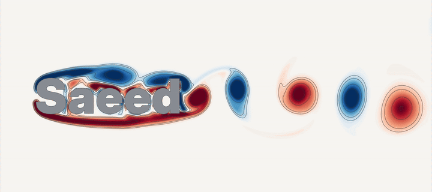
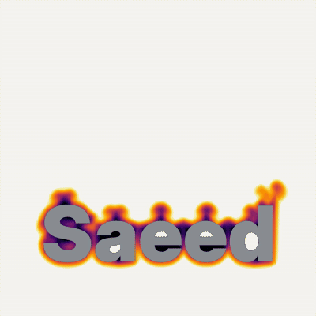
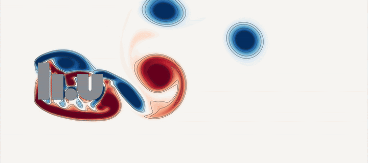
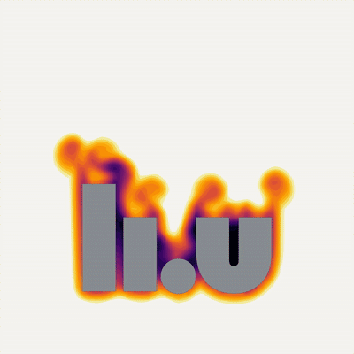

# flowOverText

Flow over a word or a logo, entirely in OpenFOAM. Give it some text (any
installed font) or an SVG logo, and it builds the mesh, runs the 2D
simulation and renders a clean vector-style animation.

| Vortex shedding (Re = 1000) | Natural convection (Ra = 10⁷) |
|:---:|:---:|
|  |  |
|  |  |

The full movies (mp4) and their last frames as SVG are in [results/](results/).

## Quick start

```sh
source ~/OpenFOAM/OpenFOAM-v2606/etc/bashrc

./flowOverText.py examples/saeed.yaml --run                          # vortex shedding
./flowOverText.py examples/saeed.yaml --set mode=convection --run    # hot letters
./flowOverText.py examples/LiU.yaml --run                            # an SVG logo
```

Each run creates a case in `cases/<name>_<mode>/`, and the movie ends up in
its `animation/` folder. A 100k-cell case takes roughly 15–30 minutes on
10 cores.

To try a word or a font before running anything:

```sh
./flowOverText.py examples/saeed.yaml --set geometry.text=Hello --set "geometry.font=DejaVu Serif:bold" --preview
```

**Requirements:** OpenFOAM v2606 (ESI), Python 3 with NumPy, SciPy,
Matplotlib, contourpy and PyYAML, ffmpeg, and fontconfig (`fc-match`) for
font names.

## How it works

1. **Geometry.** The text (or SVG) becomes closed outlines, scaled so that
   the total height is H = 1, and is written as a thin extruded STL.
2. **Mesh.** blockMesh gives a graded background mesh that is uniform over
   the animation window. snappyHexMesh refines near the letters and adds
   8 body-fitted prism layers. extrudeMesh then turns the result into a
   one-cell-thick 2D mesh.
3. **Solve.** There are two modes:
   - `forced`: uniform flow from the left (`pimpleFoam`, laminar).
   - `convection`: hot letters in cold air at rest (`buoyantPimpleFoam`,
     Boussinesq, gravity downwards).
4. **Render.** `render.py` samples the field on a fine grid, smooths it
   lightly, and draws filled contour bands with matplotlib, with optional
   contour lines. No ParaView is needed.

The cell sizes follow the physics: the boundary-layer and wake scales for
Re, and the thermal boundary layer and Kolmogorov scale for Ra. All sizes
are then scaled together to fit a cell budget (100k by default). The
generator prints how close to the ideal resolution the mesh is, and
`./plotMesh.py <case>` draws the mesh so you can check it.

## Settings

Everything is in one YAML file; [examples/saeed.yaml](examples/saeed.yaml)
lists all the settings with comments. Any setting can be overridden from the
command line, for example `--set forced.Re=2000` or `--set mesh.cells=150000`.

| Setting | Default | |
|---|---|---|
| `geometry.text` / `geometry.svg` | | the word(s), or an SVG file |
| `geometry.font` | `Inter Display:black` | font name (`fc-list : family style`) or font file |
| `mode` | `forced` | `forced` or `convection` |
| `forced.Re` | 1000 | Reynolds number based on the text height |
| `convection.Ra` | 1e7 | Rayleigh number based on the text height |
| `mesh.cells` | 100000 | cell budget |
| `run.np` | 16 | MPI processes |
| `run.cleanup` | true | delete the field data once the movie is made |
| `render.*` | | colours, contour lines, frame size, view window (see the example file) |

To change only the look, keep the data (`run.cleanup: false`) and re-render:

```sh
./render.py cases/Saeed_forced --cmap PuOr_r --no-lines --svg all
```

## Notes

- **SVG logos.** Filled paths and shapes work. Strokes and text must be
  converted to paths first (in Inkscape: *Object to Path*), and overlapping
  shapes should be merged.
- **Counters.** Closed holes in letters (the inside of o, e, a) contain no
  fluid and are drawn in the background colour.
- **Variable fonts.** Only the default weight of a variable font is used, so
  pick a static font file for bold weights.
  [examples/font_samples.png](examples/font_samples.png) shows a few fonts.
- **Rendering style.** It follows the cylinder-wake figures of the TMMV64
  course at Linköping University.
